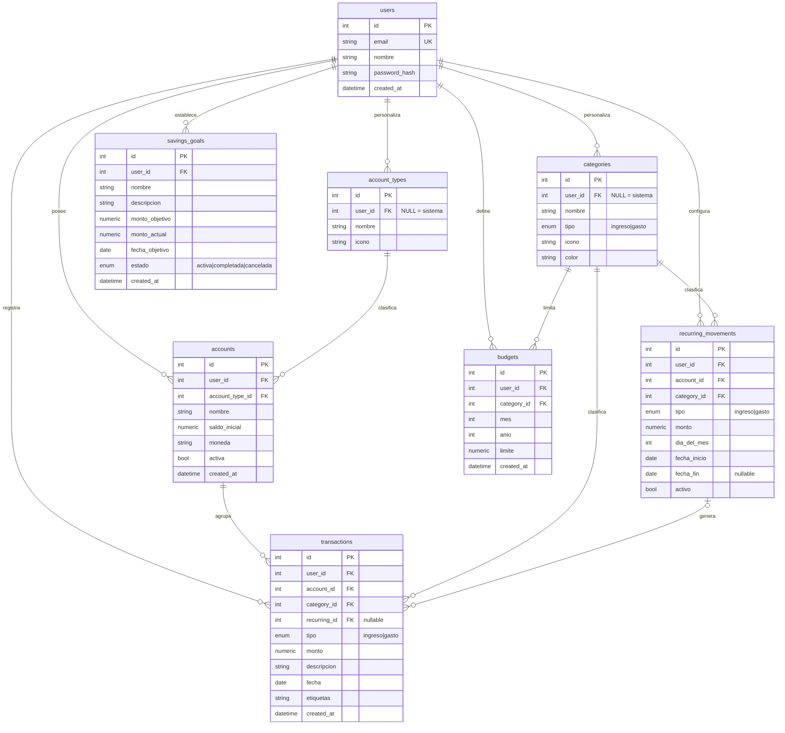

# Modelo de datos

Base de datos **PostgreSQL 16**. Ocho tablas: usuarios, cuentas, movimientos, presupuestos, metas de ahorro y sus catálogos.

## Diagrama entidad-relación



## Decisiones de diseño

**El saldo de una cuenta no se guarda como columna.** Se calcula al vuelo:

```
saldo = saldo_inicial + SUM(ingresos) - SUM(gastos)
```

Si se guardara como campo mutable habría que actualizarlo en cada alta, edición y baja de transacción, y bastaría un error para que quedara desfasado del historial. Calcularlo garantiza que el saldo y los movimientos siempre coincidan.

**Los montos usan `Numeric(14,2)`, no `float`.** Los números de punto flotante arrastran errores de redondeo (`0.1 + 0.2 != 0.3`), inaceptable cuando se trata de dinero.

**Toda tabla tiene `user_id`.** Cada consulta filtra por el usuario extraído del token JWT, de modo que un usuario nunca puede leer ni modificar datos de otro (RNF-002).

**Los tipos de cuenta son una tabla, no un enum.** Empezaron siendo un enum fijo con cuatro valores escritos en el código, pero eso impedía que alguien registrara, por ejemplo, una billetera virtual o un préstamo. Ahora siguen el mismo patrón que las categorías: los cuatro del sistema tienen `user_id = NULL` y cada usuario puede agregar los suyos. La migración `2f312f981bab` convirtió la columna conservando las cuentas ya cargadas.

**Las categorías predefinidas tienen `user_id = NULL`.** Se cargan una sola vez con el script de seed y son visibles para todos; las categorías personalizadas del usuario conviven con ellas en la misma tabla (RF-003).

**Los movimientos fijos generan transacciones reales.** Cada transacción generada guarda en `recurring_id` de qué plantilla salió, para no duplicarla. Al borrar la plantilla los movimientos ya generados se conservan: son plata que el usuario ya gastó (RF-008).

**Lo gastado de un presupuesto tampoco se guarda.** Por la misma razón que el saldo: `budgets` guarda solo el límite, y lo gastado se suma con una consulta agrupada sobre los gastos de la categoría en ese mes. Así, editar o borrar un movimiento corrige el presupuesto sin hacer nada más (RF-004).

**Restricción única en presupuestos:** `(user_id, category_id, anio, mes)`. No puede haber dos límites para la misma categoría en el mismo mes. Además, `mes` está entre 1 y 12 y el límite tiene que ser mayor a cero, controlado por la propia base con `CHECK`.

**Las alertas se calculan, no se guardan.** "Atención" al llegar al 80 % del límite y "límite" al llegar al 100 %. Se comparan los montos exactos en `Numeric`: con el porcentaje en `float`, un gasto de justo el 80 % podría dar 79,999… y no avisar.

**El estado de una meta lo decide el servidor.** Pasa sola a `completada` cuando `monto_actual` alcanza `monto_objetivo`, y vuelve a `activa` si después se sube el objetivo. El usuario solo puede cancelarla o reactivarla. Así una meta nunca dice "completada" con la mitad juntada (RF-005).

**La migración `b7421f1f2a91` conserva su identificador.** Es la del Módulo 2. Se aplicó en la base de producción con el primer intento del módulo, que después se revirtió. Al rehacerlo se mantuvieron el mismo identificador y el mismo esquema: si cambiaran, el servidor no reconocería la versión en la que quedó la base y fallaría al arrancar.
