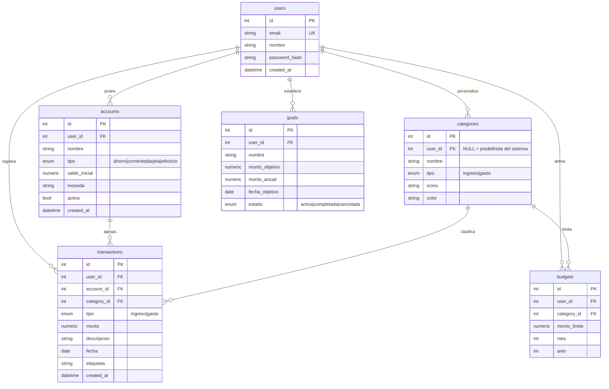

# Modelo de datos

Base de datos **PostgreSQL 16**. Seis tablas, todas colgando de `users`.

## Diagrama entidad-relación



## Decisiones de diseño

**El saldo de una cuenta no se guarda como columna.** Se calcula al vuelo:

```
saldo = saldo_inicial + SUM(ingresos) - SUM(gastos)
```

Si se guardara como campo mutable habría que actualizarlo en cada alta, edición y baja de transacción, y bastaría un error para que quedara desfasado del historial. Calcularlo garantiza que el saldo y los movimientos siempre coincidan.

**Los montos usan `Numeric(14,2)`, no `float`.** Los números de punto flotante arrastran errores de redondeo (`0.1 + 0.2 != 0.3`), inaceptable cuando se trata de dinero.

**Toda tabla tiene `user_id`.** Cada consulta filtra por el usuario extraído del token JWT, de modo que un usuario nunca puede leer ni modificar datos de otro (RNF-002).

**Las categorías predefinidas tienen `user_id = NULL`.** Se cargan una sola vez con el script de seed y son visibles para todos; las categorías personalizadas del usuario conviven con ellas en la misma tabla (RF-003).

**Restricción única en presupuestos:** `(user_id, category_id, mes, anio)` — no puede haber dos presupuestos para la misma categoría en el mismo mes (RF-004).
